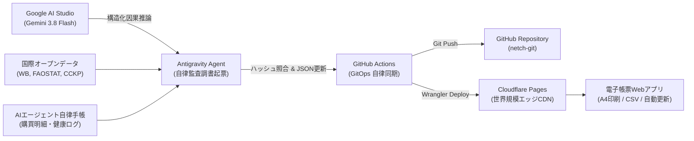

# Autonomous Intelligence Ledger (自律型インテリジェンス電子帳票)

> **Antigravity × Google AI Studio × GitHub × Cloudflare Pages による完全自律型同期・電子帳票監査システム**

[](LICENSE)
[-blue?style=flat-square)](https://aistudio.google.com)
[](https://fonts.google.com/icons)
[](style.css)
[](https://pages.cloudflare.com)

---

## 1. 概要 (Overview)

『**Autonomous Intelligence Ledger (自律型インテリジェンス電子帳票)**』は、Antigravity（自律型ペアプログラミング・エージェント）と Google AI Studio（Gemini 3.8 Flash SDK）、GitHub（GitOps自律同期）、および Cloudflare Pages（世界規模のエッジCDN）を横断連携させ、国際オープンデータ因果連鎖や自律手帳・購買ログを公的ビジネス帳票・監査調書の様式で自動記録・更新・公開するWebアプリケーションです。

### 規程・設計ガイドライン
- **絵文字完全排除（NO-EMOJI POLICY）**: 業務・学術・監査調書としての品格と可読性を保つため、システム全体（UI、帳票テーブル、ドキュメント）において絵文字を一切排除し、100% **Google Fonts Material Symbols Outlined** のベクターアイコンを採用しています。
- **公的帳票・稟議書様式美**: 電子検印・承認印（Antigravity起票 / AI Studio推論 / GitHub同期 / Cloudflare公開承認の4連印影）、JIS規格連動様式番号、SHA-256改竄防止ハッシュを標準装備。
- **A4帳票印刷・PDF出力完全対応 (`@media print`)**: ブラウザの印刷ダイアログ (`Ctrl+P` / `Cmd+P`) から、ヘッダー、印鑑、明細テーブル、署名欄がA4横（Landscape）用紙に収まる専用CSSを完備。
- **0円枠完全防護（Token & Cost Governance）**: すべての自律推論は Google AI Studio の無料APIキー枠（Gemini 3.8 Flash）で完結させ、有料課金ルート（Vertex AI）へのフォールバックを遮断しています。

---

## 2. 外部連携リンク集 (External Links & Portals)

本システムと相互接続されている主要リソースへの直結リンクです。

| 対象リソース | リンク種別 | URL / アクセス先 |
| :--- | :--- | :--- |
| **GitHub 本リポジトリ** | ソースコード・構成管理 | [netch-git/autonomous-intelligence-ledger](https://github.com/netch-git/autonomous-intelligence-ledger) |
| **GitHub README 仕様書** | 仕様・設計ドキュメント | [README.md 直リンク](https://github.com/netch-git/autonomous-intelligence-ledger#readme) |
| **World Pulse Chronicle** | 国際オープンデータ自律サイト | [world-pulse-chronicle.pages.dev](https://world-pulse-chronicle.pages.dev) |
| **連携元 GitHub リポジトリ** | 因果分析・データパイプライン | [netch-git/World-Pulse-Chronicle](https://github.com/netch-git/World-Pulse-Chronicle) |
| **Google AI Studio** | Gemini 3.8 Flash 推論環境 | [aistudio.google.com](https://aistudio.google.com) |
| **Cloudflare Pages 管理** | エッジホスティング | [dash.cloudflare.com](https://dash.cloudflare.com) |

---

## 3. システムアーキテクチャ (System Architecture)



---

## 4. 主な機能 (Core Features)

1. **リアルタイム自動更新エンジン (Live Auto-Sync Engine)**:
   - 30秒 / 1分 / 5分 / 停止 の更新サイクルを自由に選択可能。
   - 次回更新までのプログレスバーゲージおよび手動「今すぐ更新」ボタン。
2. **多次元フィルタ & 全文検索**:
   - 分類別（食料・農業インフレ、気候・エネルギー、マクロ経済・為替、サプライチェーン、手帳・健康購買、要警戒項目）。
   - キーワード入力によるインクリメンタル検索（件名、指標、ハッシュ）。
3. **起票伝票詳細モーダル (Voucher Detail Inspection)**:
   - レコードの「開く」を押すと、詳細な因果ストーリー、予測シナリオ、データソース、数理検証指標を1枚の監査調書としてポップアップ表示。
4. **エクスポート & 印刷出力**:
   - `[ 帳票印刷 / PDF ]`: A4横形式での美しい公式帳票印刷。
   - `[ CSV出力 ]`: 現在フィルタ中のデータをUTF-8 (BOM付) CSVとして一括保存。
   - `[ JSON出力 ]`: メタデータを含む構造化JSONエクスポート。

---

## 5. デプロイ手順 (Deployment Guide)

### 方法 A: Cloudflare Pages への直接デプロイ (Wrangler CLI)

Windows環境の場合:
```cmd
deploy_to_cloudflare.bat
```

Linux / macOS環境の場合:
```bash
chmod +x deploy.sh
./deploy.sh
```

初回実行時はブラウザが自動的に開き、Cloudflareの認証画面で「許可」を押すだけでエッジネットワークに即時デプロイされます。

### 方法 B: GitHub Actions による自動デプロイ

リポジトリの `Settings -> Secrets and variables -> Actions` に以下のシークレットを登録します:
- `CLOUDFLARE_API_TOKEN`: Cloudflare Pages のデプロイ権限を持つAPIトークン
- `CLOUDFLARE_ACCOUNT_ID`: Cloudflare アカウントID

設定完了後、`main` ブランチにプッシュするだけで `.github/workflows/deploy.yml` が自動起動し、Cloudflare Pages へ最新の帳票Webアプリがデプロイされます。

---

## 6. ディレクトリ構成 (Repository Structure)

```text
autonomous-intelligence-ledger/
├── index.html                   # 帳票Webアプリ本体 (自己完結型・埋め込みフォールバック内蔵)
├── style.css                    # 公的帳票デザイン・承認印スタイル・@media print定義
├── app.js                       # 自動更新タイマー・フィルタ・CSV出力・モーダル制御
├── data/
│   └── ledger_data.json         # 45件の統合帳票データセット (最新ハッシュ照合済)
├── scripts/
│   └── sync_ledger_data.py      # 定期同期・ハッシュ再計算・index.html同期デーモン
├── .github/
│   └── workflows/
│       ├── deploy.yml           # Cloudflare Pages / GitHub Pages 自動デプロイ
│       └── auto_sync.yml        # 定期自律データ更新ワークフロー
├── deploy_to_cloudflare.bat     # Windows用デプロイスクリプト
├── deploy.sh                    # Linux / Mac用デプロイスクリプト
├── wrangler.toml                # Cloudflare Pages 設定ファイル
├── _headers                     # セキュリティ・CORS・キャッシュ設定
├── LICENSE                      # MIT License
└── README.md                    # 本仕様書
```

---

## 7. ライセンス (License)

MIT License. Copyright (c) 2026 Antigravity Autonomous Research Lab.
